# Quickstart: OpenShift AI + Coder — a governed model, governed tools, and an agent that builds an EDA notebook

OpenShift AI serves the **model as a service** and puts the **tools behind a
gateway**. Coder runs the **agents** and the **workspaces**. This quickstart
wires them together on one cluster, then asks a Coder agent to fetch weather data
and build an exploratory data analysis notebook you open in VS Code.

| | OpenShift AI (+ Connectivity Link) | Coder |
|---|---|---|
| Model | serves a tool-calling model on your GPU; **MaaS** issues API keys and enforces a token limit per subscription | uses it as an *OpenAI Compatible* provider with one key |
| Tools | hosts the weather MCP server; the **MCP gateway** federates it under one URL with a `weather_` prefix | calls the gateway as one MCP server for every chat |
| Agent | — | runs the agent loop in the control plane; **picks a template and creates the workspace itself** |
| Workspace | — | VS Code + Jupyter on OpenShift's `restricted-v2`; `AGENTS.md` + an `eda-notebook` skill teach the agent the conventions |

```
 you ──► Coder (ns coder)  ── agent loop runs here
          ├──► MaaS gateway   https://maas.<domain>/llm/qwen25-14b/v1     API key + token limit   (OpenShift AI)
          ├──► MCP gateway    https://mcp.<domain>/mcp                    weather_history, ...    (Connectivity Link)
          │         └──► weather-mcp (ns mcp-servers) ──► Open-Meteo   (the one call that leaves the cluster)
          └──► workspace pod  "Python EDA Notebooks" template              (no keys, no model URL)
                    data/*.csv  ──►  notebooks/eda.py  ──nb-build──►  notebooks/eda.ipynb  ──►  VS Code
```

This builds on two Red Hat AI guides and doesn't repeat them:

- [rhoai-maas-guide](https://github.com/rh-aiservices-bu/rhoai-maas-guide): installs OpenShift AI with Models-as-a-Service
- [mcp-gateway-guide](https://github.com/rh-aiservices-bu/mcp-gateway-guide): explains the MCP gateway. This quickstart follows its *Track B* (an existing Gateway API class, RHCL 1.5).

## The route

Follow the steps in order. Don't move on until the **Done when** line holds.

| # | Do | Product | Done when | Time |
|---|---|---|---|---|
| 0 | [Prerequisites](#0-prerequisites) | | every *Check* answers | 5 min |
| 1 | [Install the platform](#1-install-the-platform) | OpenShift AI + Connectivity Link | `maas-api` runs and the MCP gateway CRDs exist | 30–40 min |
| 2 | [Serve the model on OpenShift AI](#2-serve-the-model-on-openshift-ai) | OpenShift AI | a keyed call returns `tool_calls`; an unkeyed one is refused | 10–20 min |
| 3 | [Put the weather MCP server behind the gateway](#3-put-the-weather-mcp-server-behind-the-mcp-gateway) | Connectivity Link | `mcp-check.sh` ends in `OK` | 10 min |
| 4 | [Deploy Coder](#4-deploy-coder) | Coder | you're logged in to Coder | 10 min |
| 5 | [Workspace image + template](#5-workspace-image-and-template) | Coder | the template shows as *Python EDA Notebooks* | 15 min |
| 6 | [Coder administration: model, tools, instructions](#6-coder-administration-connect-the-model-and-the-tools) | Coder admin UI | a chat answers, and Weather lists 3 tools | 10 min |
| 7 | [Let the agent build the EDA notebook](#7-let-the-agent-build-the-eda-notebook) | both | `notebooks/eda.ipynb` opens in VS Code with charts | 10 min |

Tested on OpenShift 4.22 with OpenShift AI 3.5.2, Connectivity Link 1.5.0 and
Coder 2.39.1. Variants (no gateway, a model endpoint outside the cluster) are in
[Appendix A](#a-variants).

You only open one URL in a browser, Coder. To print every address, and the exact
values for Coder's forms, run this at any point:

```bash
./scripts/urls.sh
```

---

## 0. Prerequisites

| Need | Why | Check |
|---|---|---|
| OpenShift 4.19+, `cluster-admin` | operators, namespaces, builds | `oc whoami` |
| One NVIDIA GPU with ≥ 24 GB (A10G, L4, L40S, …) | the model (step 2) | `oc get nodes -l nvidia.com/gpu.present=true` |
| Egress to `huggingface.co`, `*.open-meteo.com`, `open-vsx.org`, `github.com` | model download, weather data, image build (VS Code + extensions) | |
| `oc`, `helm` 3.x+, `jq`, `curl` | the scripts, Coder install | `helm version` |
| `coder` CLI, same version as the server | template push | `coder version`. Easiest after step 4: download it from your own Coder (below) |

Workshop and sandbox clusters often have a self-signed API certificate. If
`oc login` says *certificate signed by unknown authority*, add
`--insecure-skip-tls-verify`.

Postgres and the workspace home volumes use the cluster's **default StorageClass**
(`oc get sc`). To pick another one for workspaces, set the template's
`storage_class` variable.

---

## 1. Install the platform

Two operators, both from Red Hat, each with a check.

**OpenShift AI with Models-as-a-Service.** Use the MaaS guide's installer. It
installs OpenShift AI 3.x, Red Hat Connectivity Link, cert-manager, LWS, the GPU
operators if needed, and the `maas-default-gateway`. Pass `--skip-models`: step 2
deploys the agent model.

```bash
git clone https://github.com/rh-aiservices-bu/rhoai-maas-guide.git ../rhoai-maas-guide
cd ../rhoai-maas-guide && ./scripts/setup-maas.sh --skip-models && cd -
oc get deploy maas-api -A          # READY 1/1 (ns redhat-ai-gateway-infra on 3.5+)
```

**Red Hat Connectivity Link 1.5**, which provides the MCP gateway (step 3). The
MaaS installer usually brings it; check, and install it if it's missing:

```bash
oc api-resources --api-group=mcp.kuadrant.io | grep mcpgatewayextensions \
  || oc apply -f mcp/00-rhcl-operator.yaml
oc get kuadrantcontrolplane default \
  -o jsonpath='{.status.conditions[?(@.type=="Ready")].status}{"\n"}'      # True after ~1-2 min
```

A cluster with OpenShift AI but without MaaS works too: the gateway runs on
OpenShift AI's own `data-science-gateway-class`, and step 2 then needs a model
endpoint of your own ([Appendix A](#a-variants)).

**Done when** `maas-api` is running and `kuadrantcontrolplane default` is Ready.

---

## 2. Serve the model on OpenShift AI

Any tool-calling model deployed on OpenShift AI and published through MaaS works.
To pick one, see [Discover the Red Hat OpenShift AI model catalog](https://www.redhat.com/en/blog/discover-red-hat-openshift-ai-model-catalog)
by Diego Garcia Perez: compare validated models by accuracy, latency and hardware,
and deploy one with a few clicks. `model/` is the tested example, Qwen2.5 14B on
one 24 GB GPU.

### 2.1 Deploy the model

```bash
oc apply -k model/
oc get llminferenceservice -n llm -w          # READY True after ~5-10 min
```

`model/` follows the MaaS guide's model layout (`05-maas-models/<model>/`):

| File | What it does | Product feature |
|---|---|---|
| `llm/model.yaml` | `LLMInferenceService` on vLLM, attached to `maas-default-gateway` | serving |
| `maas/maas-model.yaml` | `MaaSModelRef`, which lists the model in the MaaS catalog | catalog |
| `maas/maas-auth-policy.yaml` | `MaaSAuthPolicy`: who may use it (`system:authenticated`) | access |
| `maas/maas-subscription.yaml` | `MaaSSubscription` `qwen25-14b-coder`: 200k tokens/min | rate limits |

Three vLLM flags matter for an agent. Each one fixed a real failure:

| Flag | Without it |
|---|---|
| `--enable-auto-tool-choice` + `--tool-call-parser=hermes` | the model chats but **never calls a tool** |
| `--max-model-len=40960` | Coder asks for `max_tokens=32000`; a 32k context rejects every request |
| an *Instruct* model, not a *Coder* one | Qwen2.5-Coder echoes tool tags as text instead of calling tools |

> **The one Coder-specific requirement: context length.** Serving the model and
> putting it behind MaaS is the standard rhoai-maas-guide flow, so any model
> deployed that way works, as long as its context window is big enough for Coder
> Agents:
>
> - **≥ 40k tokens** (`--max-model-len 40960`). Coder Agents ask for up to 32,000
>   output tokens per request, and vLLM counts prompt + output against the
>   context. A test run on 2026-11-10 used a model configured in Coder with a
>   40,000-token context limit and completed the whole EDA task.
> - Or, for a model that can't go that high, set **Max Output Tokens** on the
>   model in Coder (step 6.3) so prompt + output fits.
> - Enter the same number as **Context limit** on the model in Coder (step 6.3),
>   so Coder compacts long chats before they overflow.
> - Tool calling must be on (`--enable-auto-tool-choice` + the right
>   `--tool-call-parser`).

The guide's own `gpt-oss-20b` is pinned to an 8k context, too small for Coder.
Raise its `--max-model-len` if the GPU has room, or use `model/`.
And its *free* subscription (100 tokens/min) returns 429 on the first agent
request. That's why `model/` brings its own subscription.

### 2.2 Mint a key for Coder

The script trades your OpenShift login for a revocable key bound to the
subscription:

```bash
./scripts/maas-key.sh          # prints the key, the base URL and the model name
```

### 2.3 Check that it answers, calls tools, and is governed

```bash
HOST=https://maas.$(oc get ingresses.config cluster -o jsonpath='{.spec.domain}')
KEY=<the key>
curl -sk $HOST/llm/qwen25-14b/v1/chat/completions \
  -H "Authorization: Bearer $KEY" -H 'Content-Type: application/json' -d '{
    "model": "qwen2.5-14b",
    "messages": [{"role": "user", "content": "Weather in Oslo?"}],
    "tools": [{"type": "function", "function": {"name": "current_weather",
      "parameters": {"type": "object", "properties": {"city": {"type": "string"}}}}}]
  }' | jq -c '.choices[0].message.tool_calls'

curl -sk -o /dev/null -w '%{http_code}\n' $HOST/llm/qwen25-14b/v1/models    # no key
```

**Done when** the first call prints a `current_weather` call with `{"city":"Oslo"}`
and the second prints `401`.

> The per-model path `/llm/qwen25-14b/v1` accepts the short model name. On the
> shared `$HOST/v1` path, MaaS wants the canonical id from `$HOST/v1/models`
> (`publishers/llm/models/...`), and the short name returns 404.

---

## 3. Put the weather MCP server behind the MCP gateway

### 3.1 Deploy the server and the gateway

```bash
./mcp/apply.sh
```

It takes 2–3 minutes and ends with:

```
==> using GatewayClass data-science-gateway-class
...
mcpserverregistration.mcp.kuadrant.io/weather-mcp condition met

    MCP endpoint for Coder:  https://mcp.apps.<domain>/mcp
```

### 3.2 Check the gateway resources

```bash
oc get gateway -n gateway-system
oc get mcpgatewayextension -n mcp-system
oc get mcpsr -n mcp-servers
```

You should see (the class is whichever your cluster has):

```
NAME          CLASS                        ADDRESS                                         PROGRAMMED
mcp-gateway   data-science-gateway-class   mcp-gateway-data-science-gateway-class.gat...   True
NAME   READY
mcp    True
NAME          PREFIX     TARGET              PATH   READY
weather-mcp   weather_   weather-mcp-route   /mcp   True
```

### 3.3 Make a real tool call through the gateway

```bash
./scripts/mcp-check.sh
```

You should see the three weather tools, the gateway's two built-in tools, and a
live answer:

```
==> initialize   https://mcp.apps.<domain>/mcp
==> tools/list
    select_tools
    weather_forecast
    weather_history
    weather_current_weather
    discover_tools
==> tools/call weather_current_weather(city=Amsterdam)
    Amsterdam, North Holland, The Netherlands at ...: overcast, 7.0°C (feels like 4.4°C), wind 7.2 km/h
OK
```

If `tools/list` shows only `discover_tools` and `select_tools`, see the
*Classic protocol only* note below.

### What `apply.sh` set up

`apply.sh` builds `mcp/weather/` into the internal registry (a binary build, so
there are no registry credentials and no CI) and deploys it. It then sets up the
gateway as in the MCP gateway guide, phases 2–4 on **Track B**. The cluster
already has a Gateway API class from the Ingress Operator, so there's no OSSM3 or
Istio install and no second `Kuadrant` CR. `apply.sh` picks the class that exists:
`openshift-default` (MaaS setups) or `data-science-gateway-class` (created by
OpenShift AI). Set `GATEWAY_CLASS=` to choose another.

| File | What it does |
|---|---|
| `01-gateway.yaml` | `Gateway` with an `mcp` listener (clients) and an `mcps` listener (`*.mcp.local`, broker → servers); the gateway Service is ClusterIP; `ReferenceGrant`; `MCPGatewayExtension` with an explicit `privateHost` |
| `02-weather-mcp.yaml` | the server: no ServiceAccount token, `restricted-v2` |
| `03-gateway-registration.yaml` | `HTTPRoute` `weather.mcp.local` + `MCPServerRegistration` with prefix `weather_` |
| `04-gateway-route.yaml` | Route `https://mcp.<domain>/mcp`, with a 5 min timeout for slow tool calls |

Two settings come from the guide's notes on running next to MaaS:

| Setting | Without it |
|---|---|
| gateway Service `ClusterIP` (via `infrastructure.parametersRef`) | on a cluster without a cloud load balancer, the MCP gateway takes MaaS's only MetalLB IP and MaaS stays `AddressNotAssigned` |
| `privateHost` = `mcp-gateway-<GatewayClass>.gateway-system.svc...` | `initialize` and `tools/list` work but **every `tools/call` fails**. This is why `mcp-check.sh` makes a real call |

The server's three tools appear behind the gateway as:

| Tool | Returns |
|---|---|
| `weather_current_weather(city)` | one line |
| `weather_forecast(city, days=7)` | CSV, 1–16 days |
| `weather_history(city, start_date, end_date, frequency="monthly", variables=[...])` | CSV time series from 1940 onward, aggregated **in the server**; variables `temperature_mean`, `precipitation`, … |

`history` ends with a checksum line the agent uses to verify the file it saves:

```
# Amsterdam, North Holland, The Netherlands (52.37, 4.89), monthly, 2020-01-01..2024-12-31; units: temperature_mean °C, precipitation mm; source: Open-Meteo ERA5
period,temperature_mean,precipitation
2020-01,6.44,58.0
...
# rows=60 sum_temperature_mean=672.2 sum_precipitation=5064.5
```

Requests over 240 rows are refused, with a message telling the model how to narrow
them. Coder leaves about 9k prompt tokens on this model, so tool results must stay
small.

`tools/list` also shows two tools the gateway adds itself, `discover_tools` and
`select_tools` (GA in Connectivity Link 1.5). Agents can use them to browse and
narrow a large tool set; with three tools they're harmless.

> **Classic protocol only.** The weather server answers requests for the new
> `2026-07-28` MCP protocol with "unsupported version" (`ClassicProtocolOnly` in
> `server.py`). The gateway in Connectivity Link 1.5 negotiates the newest
> protocol with each server and then shows that server's tools *only* to clients
> on the same protocol. Coder 2.39 is a classic client, so without this it would
> see just `discover_tools` and `select_tools`. Set `MCP_ALLOW_2026=1` on the
> Deployment once gateway and clients handle the new protocol. Any MCP server
> built on a 2026-capable SDK (mcp ≥ 2.3 for Python) behind this gateway needs the
> same treatment.

**Done when** `mcp-check.sh` lists `weather_current_weather`, `weather_forecast`
and `weather_history`, and ends in `OK`, after a real `tools/call`.

---

## 4. Deploy Coder

### 4.1 Install Coder

```bash
./coder/deploy.sh
```

This creates:
- the `coder` namespace
- Postgres, with a generated password that re-runs reuse
- the `ingress-ca` ConfigMap (see below)
- the Coder Helm release (`coder/values.yaml`, chart pinned to 2.39.1)
- an edge Route

It ends with the URL:

```
    https://coder.apps.<domain>
```

Check that it runs without extra privileges:

```bash
oc get pods -n coder -l app.kubernetes.io/name=coder
oc get pod -n coder -l app.kubernetes.io/name=coder \
  -o jsonpath='{.items[0].metadata.annotations.openshift\.io/scc}{"\n"}'
```

```
NAME                     READY   STATUS    RESTARTS   AGE
coder-857bbc6454-dg7mq   1/1     Running   0          2m
restricted-v2
```

### 4.2 Create the first admin

Open `https://coder.<domain>` in a browser. Coder has **no default login**: the
first person to open the URL sees a *Create your first user* form and becomes the
admin. Pick a username, email and password.

### 4.3 Install the CLI and log in

The Coder server serves CLI binaries that match its own version. Download yours
and log in:

```bash
CODER_URL=https://coder.$(oc get ingresses.config cluster -o jsonpath='{.spec.domain}')
mkdir -p ~/.local/bin
curl -fsSLk -o ~/.local/bin/coder "$CODER_URL/bin/coder-$(uname -s | tr A-Z a-z)-$(uname -m | sed 's/x86_64/amd64/;s/aarch64/arm64/')"
chmod +x ~/.local/bin/coder            # make sure ~/.local/bin is on your PATH
coder login "$CODER_URL"               # opens the browser for a token
```

You should see:

```
Welcome to Coder, admin! You're authenticated.
```

CLI sessions expire after 24 hours; run `coder login` again when you see
*signed out or your session has expired*.

**Done when** you're logged in to Coder in the browser and `coder login` succeeded.

### What `values.yaml` changes

These settings differ from the chart defaults. Each one fixed a real failure:

| Setting | Without it |
|---|---|
| `runAsUser: null` | SCC admission rejects the pod; every project has a different UID range |
| `readOnlyRootFilesystem` + `CODER_CACHE_DIRECTORY=/tmp/coder` | Coder can't write its cache |
| `CODER_PROXY_TRUSTED_HEADERS` | VS Code websockets die with close code 1006 behind the Route |
| `SSL_CERT_DIR` incl. `/etc/ingress-ca` | x509 errors calling `maas.<domain>` / `mcp.<domain>` on a cluster with the default self-signed ingress cert |
| `CODER_MCP_ALLOWED_PRIVATE_CIDRS` (set by `deploy.sh`) | Coder blocks the MCP gateway: *"blocked: 10.10.10.10 is not allowed by the destination policy"*. See below |
| Route `timeout: 1h` | terminals and agent connections drop after 30 s |
| **no** `CODER_AI_GATEWAY_ENABLED` | the admin UI asks for **Coder Premium** (see below) |

**Why Coder needs an MCP exemption.** Since 2.39.1, Coder refuses MCP
connections to private IP addresses (SSRF protection). Inside the cluster,
`mcp.<domain>` resolves to the ingress address, which is private; on a
single-node cluster it's the node's own IP. Without an exemption the Weather
server silently drops out of every chat, and the Coder log says:

```
skipping MCP server due to connection failure ... blocked: 10.10.10.10 is not allowed by the destination policy
```

`deploy.sh` resolves `mcp.<domain>` from inside the cluster and exempts exactly
that address, printing it as it goes:

```
==> MCP private CIDRs exempted: 10.10.10.10/32
```

To set it yourself, run `MCP_ALLOWED_PRIVATE_CIDRS=<ip>/32 ./coder/deploy.sh`.
Keep it to the one address: the protection exists so that MCP server URLs can't
be used to reach arbitrary internal services.

**Licensing: this quickstart runs on Coder Community (free, no license).** That
covers Coder Agents (up to 5 concurrent), providers and models, MCP servers,
templates, `AGENTS.md` and skills. Two things need Premium, and this quickstart
uses neither:

| Premium feature | What it would do here | What this quickstart uses instead |
|---|---|---|
| Coder **AI Gateway** (AI Bridge) | a model gateway inside Coder: keys, budgets, auditing of LLM calls | **OpenShift AI MaaS**: API keys and token limits per subscription (step 2) |
| restricting Coder Agents to some members, no concurrency cap (AI Premium) | per-group access to agents | everyone in the org gets agents; access to the *model* is restricted by MaaS |

So don't turn on Coder's AI Gateway (`CODER_AI_GATEWAY_ENABLED=true`). Without a
license it does nothing except make the UI ask for Premium. The model gateway in
this story is OpenShift AI's, which is the point of the split. To check what your
deployment is entitled to:

```bash
curl -sk https://coder.<domain>/api/v2/entitlements | jq '{has_license, aibridge: .features.aibridge.entitlement}'
```

---

## 5. Workspace image and template

The workspace is where the agent writes and runs code, and where you open the
result. Coder Agents run the agent loop in the control plane, so the workspace
holds **no** model URL, API key, agent software or ServiceAccount token. It has:

- **VS Code (code-server)** with the **Python** and **Jupyter** extensions, baked
  into the image from Open VSX
- Python 3.12, pandas, numpy, matplotlib, and a `python3` Jupyter kernel
- **`nb-build`**: turns a plain `.py` file with `# %%` cells into an *executed*
  `.ipynb`. On an error it prints only the failing cell and the error. A 14B model
  writes plain Python much more reliably than notebook JSON.
- the **agent context**, seeded into the home volume at start:
  - `~/workspace/AGENTS.md`: the conventions (`data/`, `notebooks/`, never
    hand-write `.ipynb`, how to check the checksum)
  - `~/.coder/skills/eda-notebook/`: a `SKILL.md` with the EDA steps plus a
    `template.py` skeleton

### 5.1 Build the workspace image

```bash
./workspace-image/build.sh      # in-cluster build; ~10 min the first time
```

It ends with:

```
Push successful
    image: image-registry.openshift-image-registry.svc:5000/coder/coder-workspace:latest
    next:  ./template/push.sh
```

### 5.2 Push the template

```bash
./template/push.sh              # pushes, then sets display name, description and icon
```

```
Updated version at ...
Updated template metadata at ...
NAME        ORGANIZATION NAME  LAST UPDATED       USED BY
python-eda  coder              ...
```

In the browser, **Templates** now shows it, with the description Coder Agents
will choose it by:

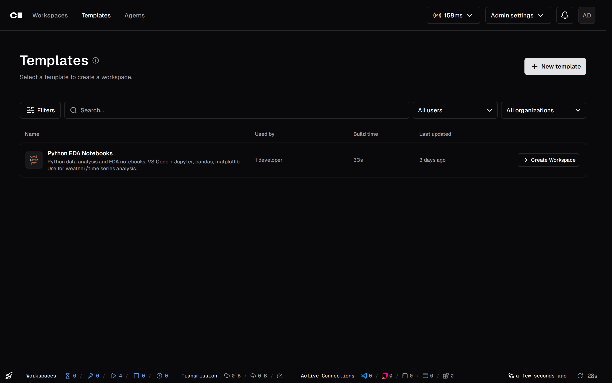

Both scripts are safe to re-run: `build.sh` creates the BuildConfig once and
rebuilds, and `push.sh` adds a new template version.

### 5.3 Allow Coder Agents to use it

**Admin settings → AI → Coder Agents → Templates.** The switch next to *Python
EDA Notebooks* must be on. Templates allow agents by default; this is where you'd
hide a template from agents without hiding it from people:

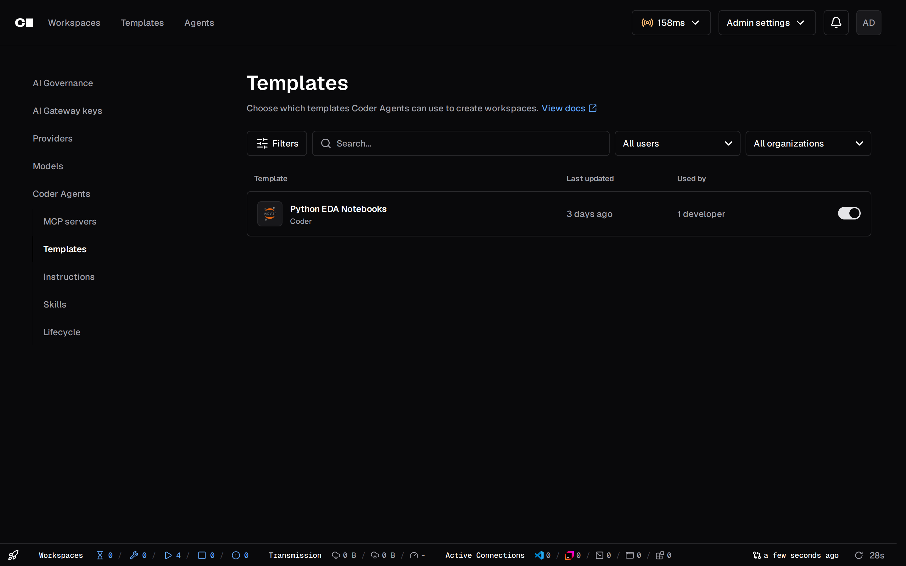

### 5.4 Try a workspace yourself

Before handing the template to an agent, create one throwaway workspace:

```bash
coder create eda-test --template python-eda --use-parameter-defaults --yes
coder ssh eda-test -- 'ls ~/workspace ~/.coder/skills; jupyter kernelspec list; curl -s localhost:13337/healthz'
```

You should see:

```
/home/coder/.coder/skills:
eda-notebook

/home/coder/workspace:
AGENTS.md
data
notebooks
Available kernels:
  python3    /usr/local/share/jupyter/kernels/python3
{"status":"expired","lastHeartbeat":0}
```

`{"status":"expired"}` is fine: it only means no browser has connected yet. Under
**Workspaces**, it shows with the template's icon and three buttons: **VS Code
(notebooks)** in the browser, VS Code Desktop, and a terminal:

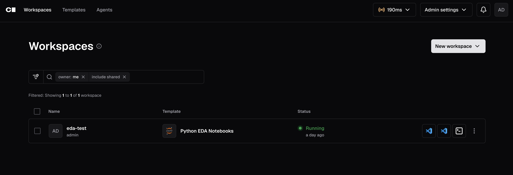

Delete it when you're done, so the agent starts clean:

```bash
coder delete eda-test --yes
```

### How Coder Agents use the template

When a chat needs a workspace, the agent
calls `list_templates` and picks a template from its **description** (≤128
characters) and the top of its **README** (`template/README.md`, about the first
1,000 characters). It never reads the Terraform. It fills in parameters itself,
which is why every parameter has a default. It then calls `create_workspace`.
`startup_script_behavior = "blocking"` makes that call wait until `AGENTS.md` and
the skill exist. `coder_agent.dir = ~/workspace` is where the agent looks for
`AGENTS.md` and where its commands start.

### Your own templates

`template/` is one example. You can add more from the UI
under **Templates → Create template**: *Upload an existing template* (a folder or
zip with `main.tf`), *Start from scratch*, or a community template. On OpenShift,
start from a copy of `template/` rather than the stock *Kubernetes (Deployment)*
starter, which hardcodes `runAsUser: 1000` and is rejected by `restricted-v2`.
Give each template a clear description and parameter defaults, so the agent can
choose it.

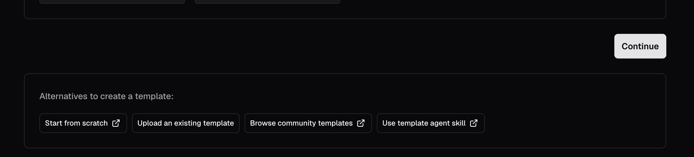

**Done when** `coder templates list` shows `python-eda`, and *Admin settings → AI →
Coder Agents → Templates* has it switched on (templates allow agents by default).

---

## 6. Coder administration: connect the model and the tools

Everything in this step happens in Coder's web UI, logged in as the admin from
step 4. The screenshots are from Coder v2.39. To print the values for the forms:

```bash
./scripts/urls.sh
```

### 6.1 Open the AI settings

Every admin page in this step lives under **Admin settings → AI**, with a menu on
the left: *Providers, Models, Coder Agents* and, under it, *MCP servers,
Templates, Instructions, Skills*. There are two ways in.

**Way 1, from the top bar.** Click **Admin settings** (top right) and choose **AI**:

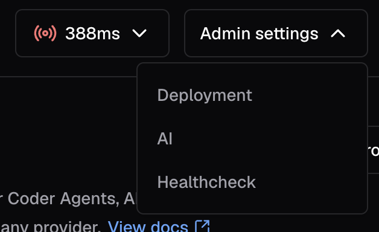

**Way 2, from the Agents page.** Useful when you're already chatting:

1. Click **Agents** in the top bar.

   

2. Click the **⚙** next to *New chat* (or press ⌘ ,).

   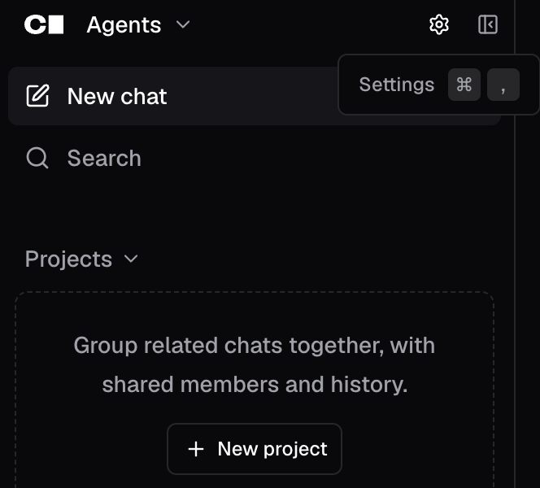

3. That opens your *personal* agent settings (*General, Skills, Compaction,
   Secrets*). Click **Manage agents ↗** to jump to the admin pages.

   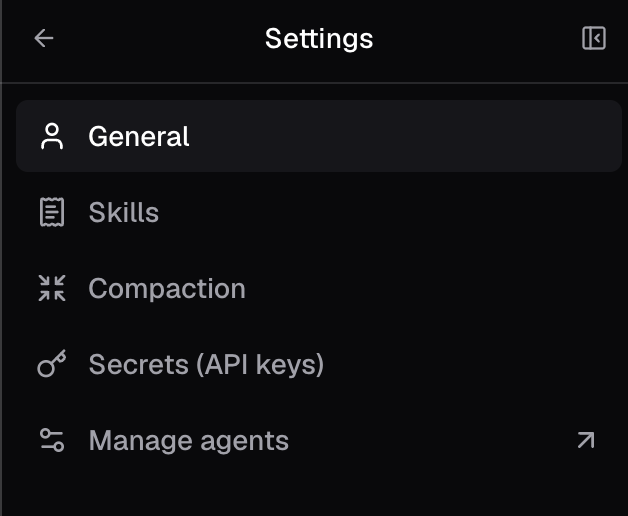

### 6.2 Add the provider

1. In the AI menu, click **Providers**, then **Add**.
2. Choose **OpenAI Compatible**. This opens *Add an OpenAI-compatible provider*:

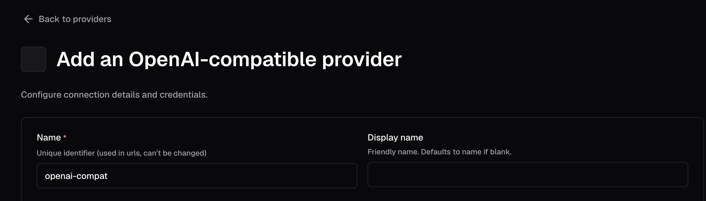

| Field | Value |
|---|---|
| Name | a unique id used in URLs, **can't be changed later**, e.g. `openshift-ai-maas` (the screenshots call it `qwen`) |
| Display name | optional |
| Base URL | the MaaS URL from step 2, `https://maas.<domain>/llm/qwen25-14b/v1` |
| API key | from `./scripts/maas-key.sh` |

3. Fill in the form and click **Save**. The base URL must **end in `/v1`**,
   because Coder appends `/chat/completions`.

### 6.3 Add the model

1. In the AI menu, click **Models**.
2. Click **Add model ▾**. *Select a provider* lists the provider you just added
   (here it's called `qwen`). Pick it:

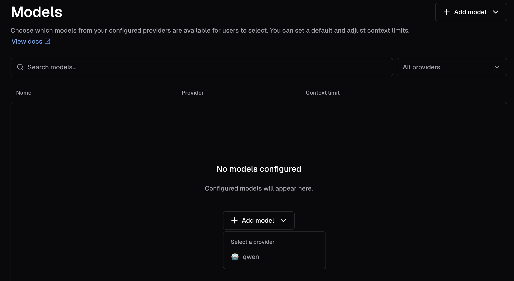

3. Fill in the model form and click **Save**:

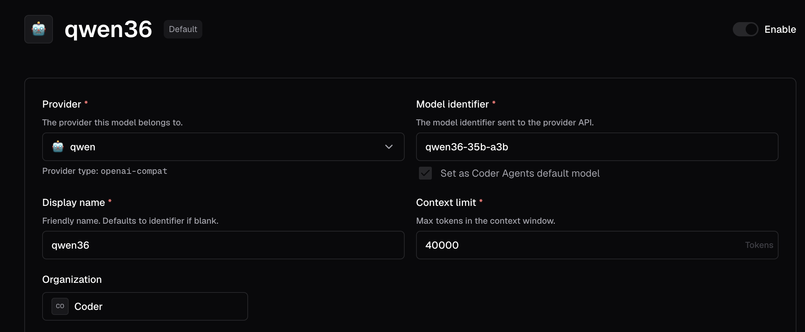

| Field | Value |
|---|---|
| Provider | the provider from 6.2 |
| **Model identifier** | the **exact** name the endpoint serves, sent to the API as-is: `qwen2.5-14b` for `model/`; otherwise the name from the endpoint's `/v1/models` list (the screenshot shows `qwen36-35b-a3b`) |
| Display name | anything friendly, e.g. `qwen36`. This is what users see in the chat |
| Context limit | the model's context window, e.g. `40000` (`model/` serves 40,960) |
| Set as Coder Agents default model | ✔. The first model you add is the default anyway |

**Get the identifier right.** A short or friendly name in *Model identifier*
(`qwen36` instead of `qwen36-35b-a3b`) doesn't always give "model not found".
Some endpoints, LiteLLM among them, answer **unauthorized**, so Coder reports *Authentication with OpenAI
Compatible failed… all configured keys failed authentication*, even though the
key is fine. To list the names your key may use:

```bash
curl -s -H "Authorization: Bearer $KEY" https://<endpoint>/v1/models | jq -r '.data[].id'
```

Further down, the form has:

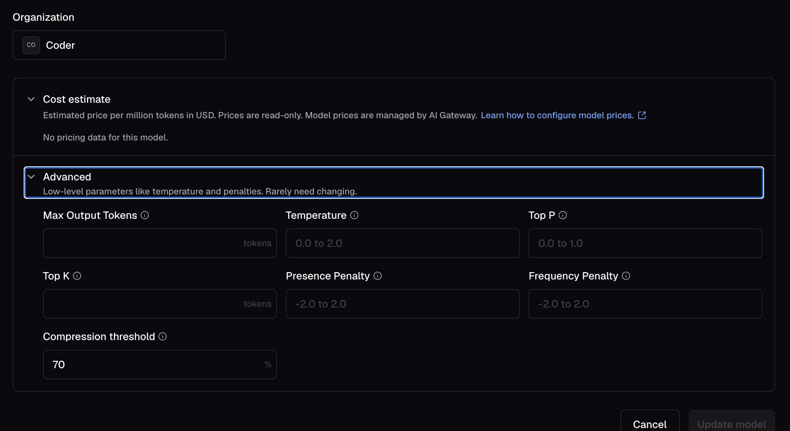

- **Cost estimate** is read-only. Prices come from Coder's AI Gateway (Premium,
  not used here), so it says *No pricing data*. That's expected.
- **Advanced → Max Output Tokens.** Leave it empty for a large-context model. For
  a small-context one, set it here: Coder otherwise asks for 32,000 output tokens,
  and a model with a 32k context rejects every request. `model/` avoids this with
  `--max-model-len 40960` (step 2).
- Leave temperature and the other parameters empty. *Compression threshold*
  (default 70 %) is when Coder starts compacting a long chat.

### 6.4 Add the weather MCP server

1. In the AI menu, under **Coder Agents**, click **MCP servers**, then **Add server**.
2. Fill in the top of the form:

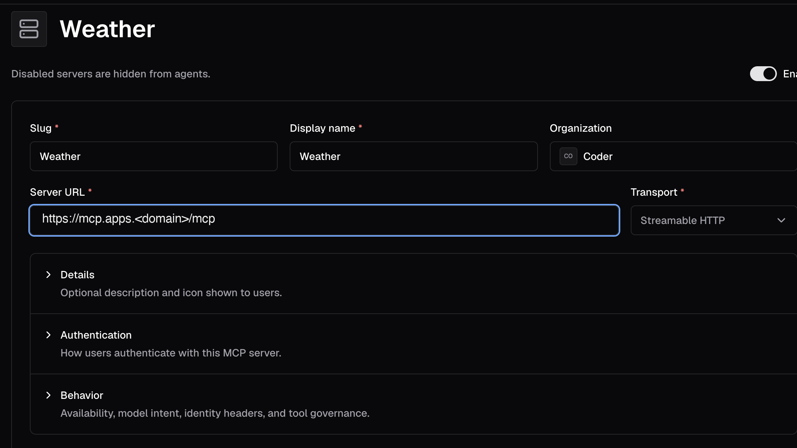

| Field | Value |
|---|---|
| Slug / Display name | `Weather` |
| Organization | your organization (default `Coder`) |
| Server URL | the MCP gateway, `https://mcp.<domain>/mcp` (`./scripts/urls.sh` prints it) |
| Transport | **Streamable HTTP** |
| Details | optional description and icon |
| Authentication method | **None** (OIDC: [Appendix B](#b-per-user-tool-access-on-the-gateway)) |

3. Scroll to **Behavior** and set availability:

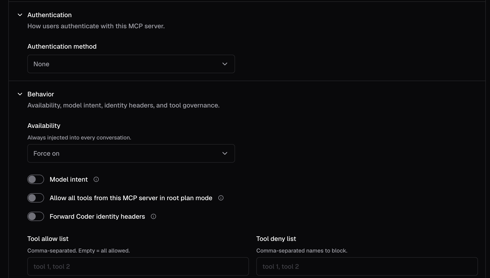

| Setting | Value | Why |
|---|---|---|
| Availability | **Force on** | injected into every chat; users can't switch it off |
| Model intent, plan-mode tools, identity headers | off | not needed for this demo |
| Tool allow / deny list | empty | all three tools allowed. A deny list is how Coder hides tools without touching the server |

4. Click **Save**. The server now shows in the list, with its auth method and
   availability. If a chat later can't reach it, it's almost always Coder's
   private-IP block (step 4), not authentication:

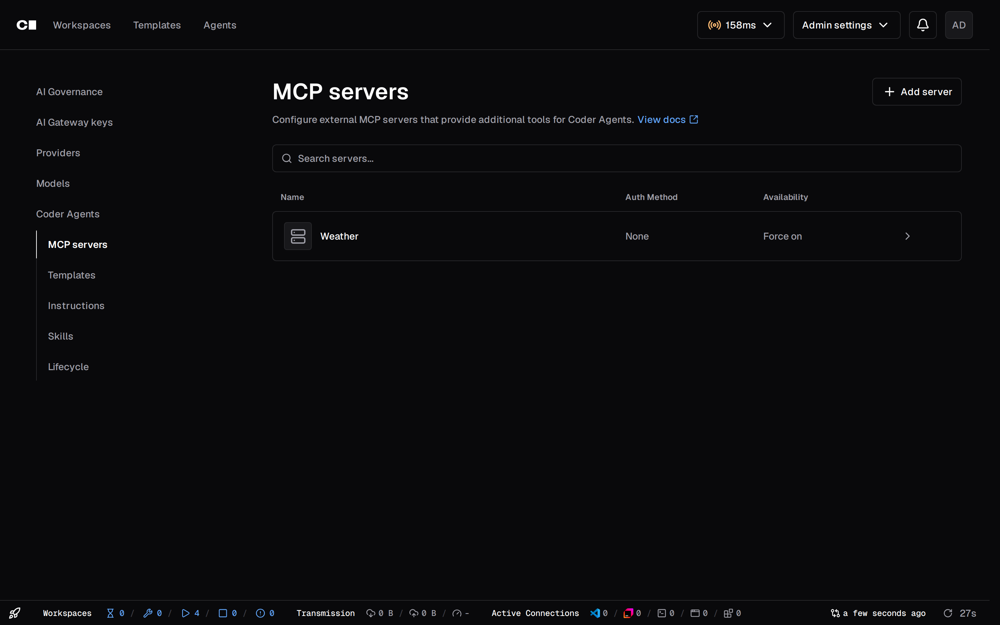

### 6.5 Tell agents to create the workspace first

`AGENTS.md` and the skill live *inside* the workspace, so before one exists the
agent has no instruction to create it. Smaller models then try `mkdir` straight
away and get *"this tool requires a workspace and this chat does not have one"*.
A deployment-wide instruction fixes that:

1. In the AI menu, under **Coder Agents**, click **Instructions**.
2. Under **Deployment instructions**, leave *Include Coder Agents default system
   prompt* on.
3. Paste this into **Additional system instructions** and click **Save**. The
   first paragraph gives the agent its role; the second is the part that matters
   for this demo:

```
You are a useful assistant that helps data scientists and business users with EDA
and data-related questions. You have access to a weather MCP server that gets the
user weather data for the places they want.

You start without a workspace. Before running commands or writing files, call
list_templates and create_workspace. For data analysis, CSVs, charts or
notebooks, use the "Python EDA Notebooks" template. After the workspace is
ready, follow its AGENTS.md.
```

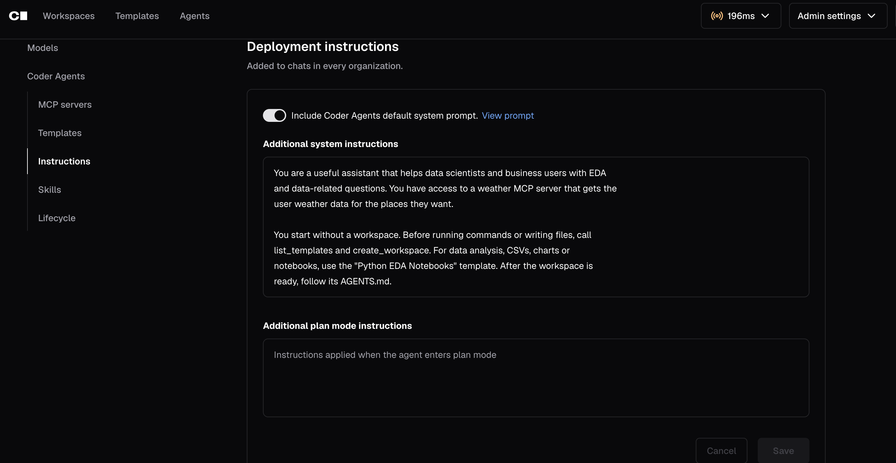

Paste **both paragraphs into the same box, *Additional system instructions***.
Leave *Additional plan mode instructions* empty: it only applies when an agent is
in plan mode, so text there doesn't reach normal chats. A role on its own isn't
enough: without the second paragraph, smaller models still try to run commands
before a workspace exists.

This is the split again: the *deployment* instruction says where to work, and
the *template's* `AGENTS.md` and skill say how to work there. Instructions apply
to **new** chats; existing chats keep the old ones.

### 6.6 Check

1. Click **Agents** in the top bar, then **New chat**.
2. Under the prompt box you should see your model and **Weather 🔒**. The lock
   means *Force on*:

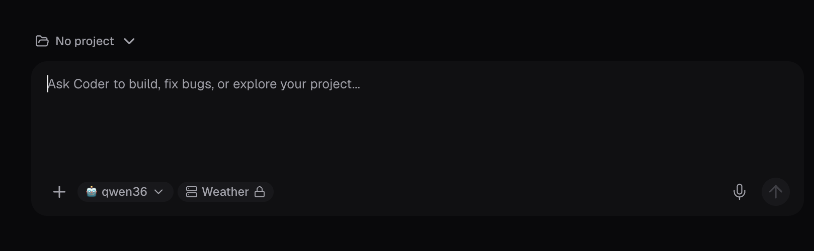

3. Type *hi*, then *which weather tools do you have?*

**Done when** the chat answers with your model and lists `weather_history`, `weather_forecast` and
`weather_current_weather` (plus the gateway's `discover_tools` and
`select_tools`).

---

## 7. Let the agent build the EDA notebook

### 7.1 Start a chat, without a workspace

Click **Agents → New chat**. Leave the project on *No project* and **don't attach
a workspace**: the point is that the agent chooses and creates one. Under the
prompt box you should see your model and **Weather 🔒** (step 6.6).

### 7.2 Warm-up: one tool call

Paste:

> What's the weather going to be in Amsterdam over the next three days?

No workspace is needed. The agent makes one forecast call through the gateway and
answers. Coder shows tool calls by a friendly label: `weather_forecast` appears
as *Weather forecast*:

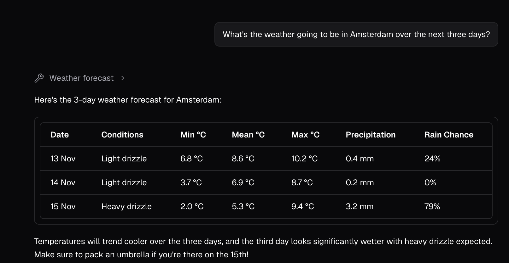

### 7.3 The task

In the same chat, paste:

> Get the monthly mean temperature and precipitation for Amsterdam, Madrid and
> Oslo from 2020-01-01 to 2024-12-31 with the weather tools. Save each city to
> `data/<city>.csv` exactly as returned and check the checksums. Then build an
> EDA notebook.

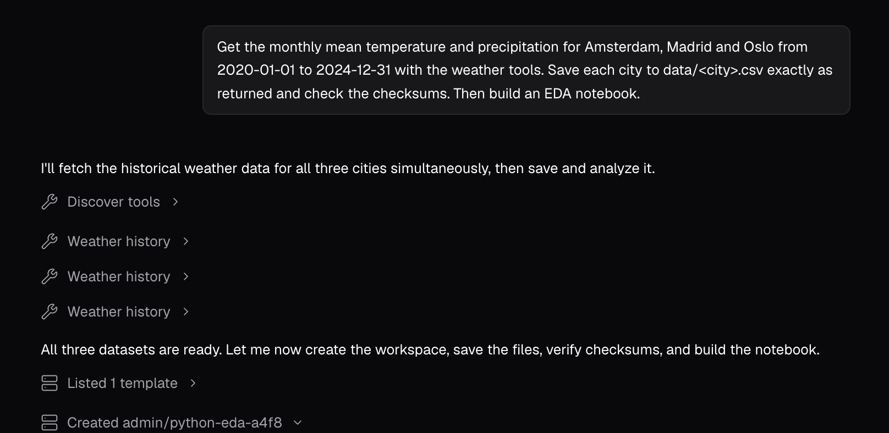

In order, the timeline shows:
- **Discover tools**: the agent asks the gateway what's available (one of the
  gateway's two built-in tools);
- three **Weather history** calls, one per city, back in seconds;
- **Listed 1 template** → **Created admin/python-eda-…**: the agent creates its
  own workspace (thanks to the 6.5 instruction).

### 7.4 Watch it work

What to point out while it runs:

1. **It creates its own workspace.** Following the instruction from step 6.5, it
   calls `list_templates` → `create_workspace` and picks *Python EDA Notebooks*
   from the template description. It takes a minute or two while the pod starts.
2. **It follows the workspace's conventions.** It saves the CSVs under `data/`,
   checks the checksums, then reads the template's `eda-notebook` skill and its
   `template.py` skeleton, writes `notebooks/eda.py`, and runs `nb-build`:

   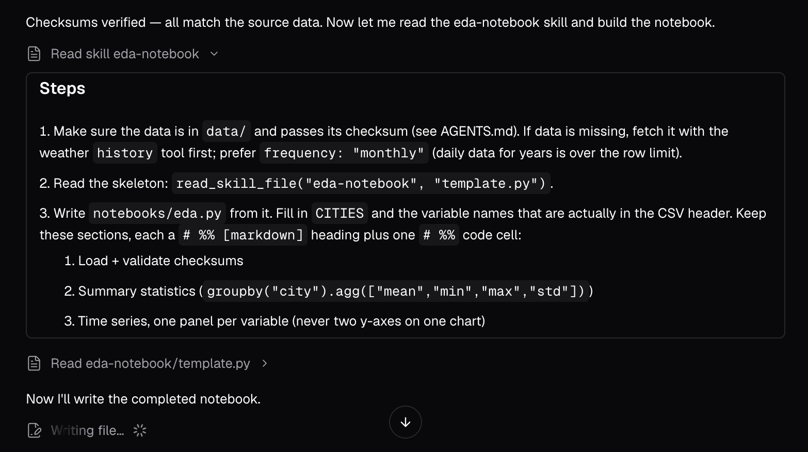

3. **It fixes its own mistakes.** It reviews its own code ("the first loop has a
   bug and is redundant"), edits `eda.py` and re-runs `nb-build`:

   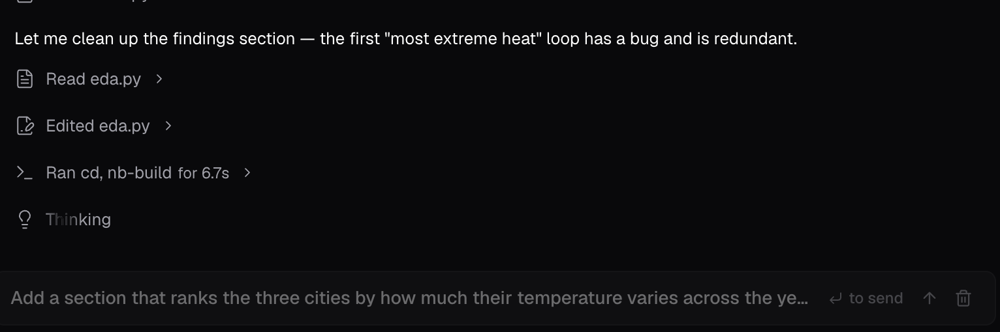

   If a cell fails, `nb-build` prints just that cell and the error, and the agent
   fixes that too:

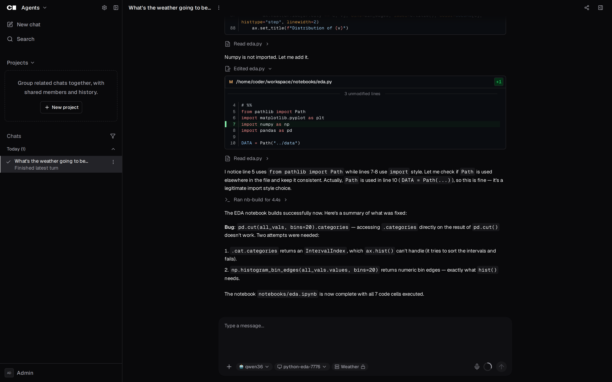

### 7.5 Open the notebook

1. Click **Workspaces** in the top bar. Every workspace an agent created carries
   an **Agent** badge and a generated name (here `python-eda-6004`,
   `python-eda-7776`, `spainweatheranalysis-e52c`, next to the manual `eda-test`):

   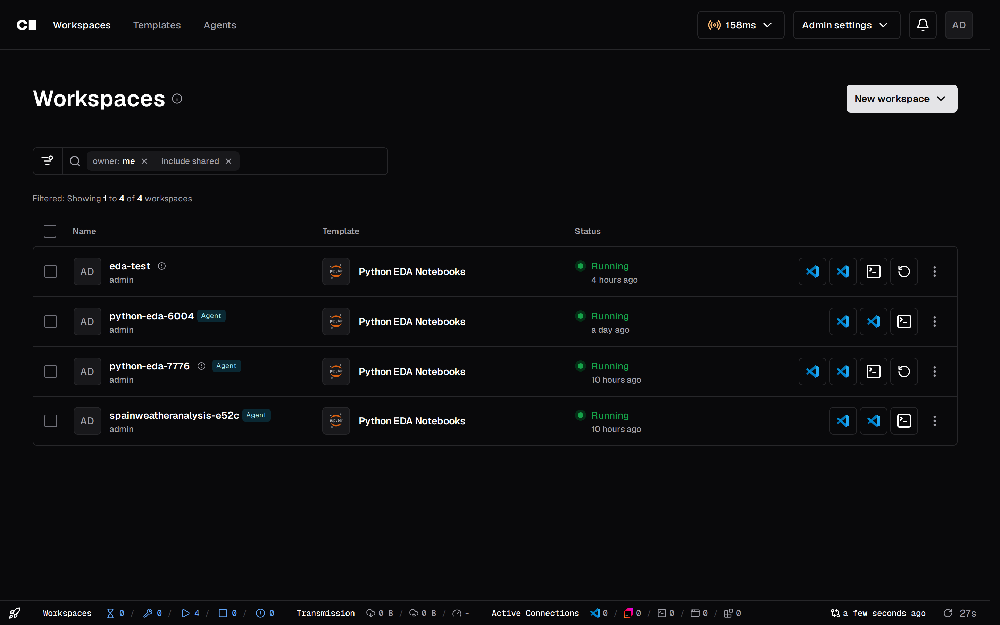

2. On the agent's workspace, click the first blue icon, **VS Code (notebooks)**.
   It opens VS Code in a new browser tab.
3. In the Explorer, open `notebooks/eda.ipynb`.

The notebook opens with its outputs already rendered, and the Python 3.12 kernel
is ready if you want to change a cell yourself:

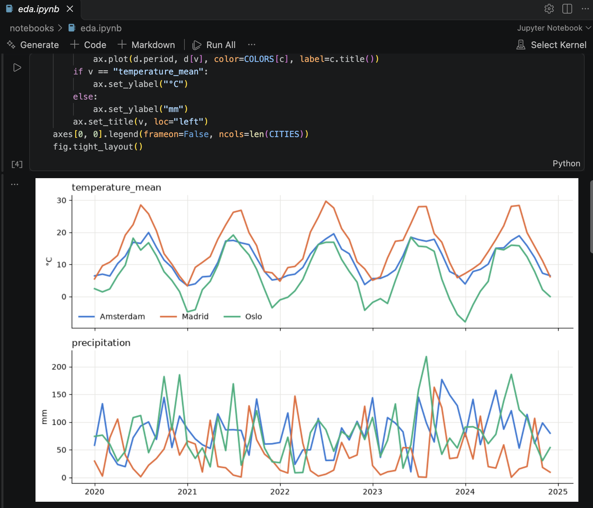

### 7.6 Follow-up: iterate

Back in the chat, paste:

> Add a section that ranks the three cities by how much their temperature varies
> across the year, with one chart.

The agent edits `notebooks/eda.py` and re-runs `nb-build`. In VS Code, reload the
notebook (close and reopen the tab) to see the new section.

### 7.7 Check the numbers

Want the notebook without an agent, or to compare cell by cell? It's written out
as copy-and-paste cells in [`analysis/NOTEBOOK.md`](analysis/NOTEBOOK.md): open
VS Code (notebooks), create `notebooks/my-eda.ipynb`, paste the cells, and **Run
All**.

These are reference numbers from
[`analysis/eda.py`](analysis/eda.py), the same notebook built from the same tool
output ([`analysis/results.md`](analysis/results.md)). The agent's code will
differ, but its numbers should match:

| Check | Amsterdam | Madrid | Oslo |
|---|---|---|---|
| rows, temperature sum (trailer) | 60, 672.2 | 60, 938.6 | 60, 419.1 |
| mean temperature | 11.2 °C | 15.6 °C | 7.0 °C |
| coldest / warmest month | Jan 5.0 / Aug 18.5 °C | Jan 5.2 / Jul 28.1 °C | Jan −2.6 / Jun 16.9 °C |
| wettest month (5-year mean) | Oct 118 mm | Sep 82 mm | Jul 142 mm |

Most unusual month: **Oslo, January 2024**, at −7.9 °C, 5.3 °C below its 2020–2024
January mean.

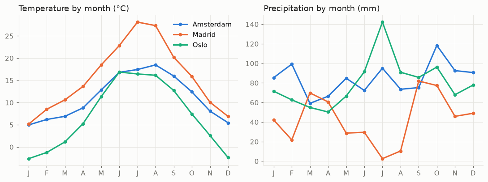

### Things worth watching for

Small models get these wrong, and they make good teaching moments:

- **Copy errors.** The agent copies each CSV into a file token by token. The
  checksum catches a dropped or mangled row; tell it to re-fetch.
- **Asking for daily data.** Five years of daily data is over the row limit. The
  tool refuses and says why, and a good agent retries with `monthly`.
- **Retyped numbers.** Numbers the code computes are reliable; numbers the model
  types into prose drift. In a test run the tables were all correct, but 3 of 5
  findings bullets were wrong ("23.4 °C warmer" instead of 8.7; a 5-year total ÷
  12 called "mm/yr"). The skill now has the findings cell *print* each number, and
  in the next run every finding was right (8.7 °C, 1012.9 mm/year). If you see
  hand-typed findings, ask the agent to *"compute the findings in code"*.
  It's also a good moment to show why the checksum and the reference table exist.
- **Hand-writing `.ipynb`.** If the agent writes notebook JSON anyway, point it at
  `AGENTS.md`.
- **Throttling, an OpenShift AI talking point.** Lower `limit` in
  `model/maas/maas-subscription.yaml` to `2000`, re-apply, and send a prompt.
  Coder gets a 429 from MaaS: the platform, not the agent, decides how much the
  agent may spend.

**Done when** `notebooks/eda.ipynb` is open in VS Code with its charts, and the
numbers match the table. That's the end of the route.

---

## Troubleshooting

| Symptom | Check | Usual cause |
|---|---|---|
| `LLMInferenceService` never Ready | `oc get pods -n llm`, then the pod log | no GPU node or quota; no egress to huggingface.co |
| Keyed curl returns 401/403 | `./scripts/maas-key.sh` again | expired key; subscription not applied (`oc get maassubscription -n models-as-a-service`) |
| 404 `model not found` | the URL | short model name on the shared `/v1` path. Use `/llm/qwen25-14b/v1`, or the canonical id from `/v1/models` |
| 429 in Coder chats | `oc get maassubscription qwen25-14b-coder -n models-as-a-service -o yaml` | token limit too low for an agent |
| Model talks but never calls tools | the curl in step 2 | tool-calling args missing, or a *Coder* model variant |
| "maximum context length" | vLLM log | `--max-model-len` below ~40k |
| Coder: x509 / certificate errors | `oc get cm ingress-ca -n coder` | ingress CA not mounted. Re-run `coder/deploy.sh` |
| Weather tools missing from chats; Coder log: *"blocked: <ip> is not allowed by the destination policy"* | `oc exec -n coder deploy/coder -- env \| grep MCP_ALLOWED` | `mcp.<domain>` resolves to a private IP that isn't exempted. Re-run `./coder/deploy.sh` (it detects the IP), or set `MCP_ALLOWED_PRIVATE_CIDRS=<ip>/32` |
| Through the gateway, `tools/list` shows only `discover_tools` and `select_tools` | `oc logs -n mcp-system deploy/mcp-gateway \| grep "upstream negotiated"` | `supported-versions=[2026-07-28]`: the server speaks the new protocol, and the gateway hides its tools from classic clients (Coder). Keep `ClassicProtocolOnly` on (default), rebuild, then `oc rollout restart deploy/mcp-gateway -n mcp-system` |
| `tools/list` works, `tools/call` fails | `./scripts/mcp-check.sh` | wrong `privateHost` in `mcp/01-gateway.yaml`; check `oc get svc -n gateway-system` |
| Gateway Route returns 503 | `oc get svc -n gateway-system` | generated Service name isn't `mcp-gateway-<GatewayClass>`; re-run `mcp/apply.sh` with `GATEWAY_CLASS=` set to the class in `oc get gatewayclass` |
| MaaS gateway `AddressNotAssigned` | `oc get svc -n gateway-system` | MCP gateway Service is a LoadBalancer; the `mcp-gateway-infra` ConfigMap wasn't applied |
| Tool calls time out | `oc logs -n mcp-servers deploy/weather-mcp` | no egress to `*.open-meteo.com` |
| Chat fails: *Authentication with OpenAI Compatible failed… all configured keys failed authentication* | `curl -H "Authorization: Bearer $KEY" <base>/v1/models` | **Model identifier** isn't the exact served name (LiteLLM answers 401 for a model the key can't use, e.g. `qwen36` vs `qwen36-35b-a3b`), or the key or base URL is wrong. See step 6.3 |
| Agent fails with *"this tool requires a workspace and this chat does not have one"* | did it call `create_workspace`? | it tried to run commands before creating a workspace. Reply *"Create a workspace first with the Python EDA Notebooks template, then continue"*, and add the instruction from step 6.5 |
| Admin UI says "requires Coder Premium" | `oc exec -n coder deploy/coder -- env \| grep AI_GATEWAY` | `CODER_AI_GATEWAY_ENABLED` set; remove it from `coder/values.yaml` and re-run `coder/deploy.sh`. Coder Agents don't need it |
| Agent picks the wrong template, or asks which one | *Templates* list | vague description; set it as in step 5. Too many similar templates |
| Chat context doesn't list AGENTS.md or the skill | the chat's context panel | snapshot pinned before the workspace finished starting. Use **Refresh context** |
| Notebook has no charts | `echo $MPLBACKEND` in the workspace | `MPLBACKEND=Agg` overrides the inline backend (`nb-build` unsets it) |
| VS Code: "select a kernel" / no kernel | Command palette → *Notebook: Select Notebook Kernel* | pick *Python 3.12*; workspace built from an older image |
| Checksum doesn't match | compare row counts | the agent dropped rows while copying; ask it to re-fetch and rewrite the file |

---

## Clean up

```bash
coder delete <workspace> --yes
helm uninstall coder -n coder
oc delete -k model/
oc delete namespace coder mcp-servers gateway-system mcp-system
# MaaS itself: see the teardown in https://github.com/rh-aiservices-bu/rhoai-maas-guide
```

---

## Appendix

Not needed for the route above.

### A. Variants

**A model endpoint outside the cluster.** Skip step 2. In step 6.2, add any
OpenAI-compatible endpoint with tool calling and a context of about 40k or more,
for example a LiteLLM proxy: base URL ending in `/v1`, and its own key. The
agent run in the screenshots used such an endpoint. You lose the MaaS keys and
limits from the story. To keep them, put the endpoint behind MaaS as an
`ExternalModel` (rhoai-maas-guide `manifests/08-external-models/litellm`, with a
subscription sized for an agent; the guide's 10k tokens/hour is too small).

**No MCP gateway** (no Connectivity Link). Run `DIRECT=1 ./mcp/apply.sh`.
`./scripts/mcp-check.sh` port-forwards to the Service by itself. In step 6.4, use
`http://weather-mcp.mcp-servers.svc.cluster.local:8080/mcp`; the tools are then
`history`, `forecast` and `current_weather`, without the prefix (`AGENTS.md` and
the skill accept both).

**A model on OpenShift AI without MaaS.** Remove `router.gateway.refs` and the
`enable-auth` annotation from `model/llm/model.yaml` and apply only `model/llm`.
Coder then uses the in-cluster workload Service
(`https://qwen25-14b-kserve-workload-svc.llm.svc.cluster.local:8000/v1`, any API
key); it trusts the service CA through `SSL_CERT_DIR`.

### B. Per-user tool access on the gateway

Follow mcp-gateway-guide phases 6–8: Keycloak, an `AuthPolicy` on the `mcp`
listener, and tool roles on `mcps`. On RHCL 1.5 next to MaaS, skip the guide's
`Kuadrant` CR, because only one is reconciled (see the guide's `rhcl-15` page).
Then set the Weather server in Coder to **User OIDC Identity**.

### C. Run the MCP server on your laptop

```bash
python3.12 -m venv /tmp/wx && /tmp/wx/bin/pip install -r mcp/weather/requirements.txt
PORT=18080 /tmp/wx/bin/python mcp/weather/server.py
MCP_URL=http://localhost:18080/mcp TOOL=current_weather ./scripts/mcp-check.sh
```

### D. Reproduce the reference notebook

```bash
/tmp/wx/bin/pip install -r workspace-image/requirements.txt
./analysis/capture.sh                    # optional: re-pull the CSVs (server from C running)
cd analysis && PATH=/tmp/wx/bin:$PATH ../workspace-image/nb-build eda.py   # eda.ipynb + results.md
```
