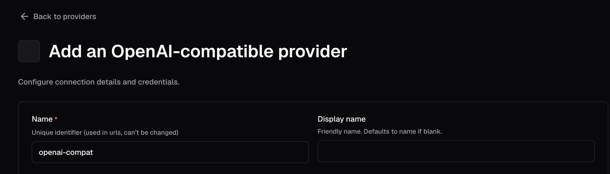
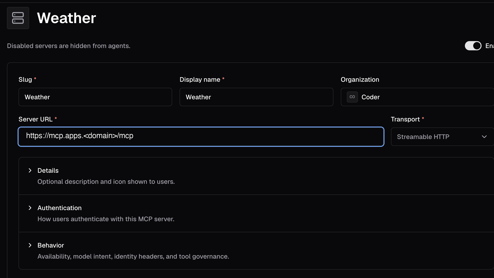
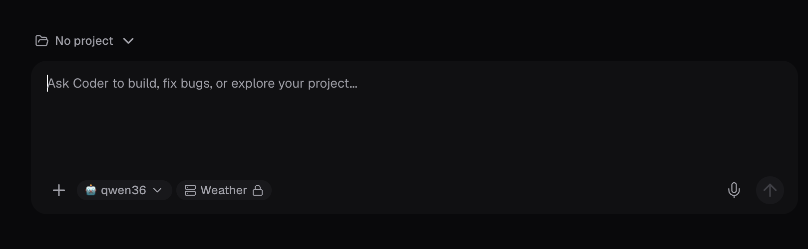

# OpenShift AI + Coder: host your own AI agent

**Red Hat OpenShift AI** serves the model as a service (Models-as-a-Service: API
keys, token limits) and hosts the tools behind the **MCP gateway** (Red Hat
Connectivity Link). **Coder** runs the agents, lets them pick a workspace
template, and gives agent and people the same workspace: VS Code + Jupyter on
OpenShift, with conventions the agent reads from `AGENTS.md` and a skill.

A small task shows both at work. A Coder agent fetches five years of monthly
weather for Amsterdam, Madrid and Oslo through the gateway, creates its own
workspace, and builds an executed EDA notebook that you open in VS Code.
Everything runs on one OpenShift cluster.

- **[QUICKSTART.md](QUICKSTART.md)**: build it step by step (about 1.5 hours, one GPU)

```bash
git clone https://github.com/KiriGould/coder-on-openshift-ai.git && cd coder-on-openshift-ai
```
- **[STATUS.md](STATUS.md)**: tested versions, what was verified end to end, known limitations

**Status (2026-11-13):** tested on OpenShift 4.22 with OpenShift AI 3.5.2,
Connectivity Link 1.5.0 and Coder 2.39.1. The MCP gateway, Coder, the template
and an end-to-end agent run were verified on a cluster; the model step is the
standard OpenShift AI MaaS flow. Details are in [STATUS.md](STATUS.md).

```
 you ──► Coder  ── agent loop
          ├──► OpenShift AI MaaS     https://maas.<domain>/llm/<model>/v1   API key + token limit
          ├──► MCP gateway (RHCL)    https://mcp.<domain>/mcp                weather_history, weather_forecast, ...
          │        └──► weather MCP server ──► Open-Meteo
          └──► workspace  "Python EDA Notebooks"   data/*.csv ──► notebooks/eda.py ──nb-build──► eda.ipynb
```

It builds on two Red Hat AI guides:
- [rhoai-maas-guide](https://github.com/rh-aiservices-bu/rhoai-maas-guide) installs OpenShift AI with MaaS.
- [mcp-gateway-guide](https://github.com/rh-aiservices-bu/mcp-gateway-guide) explains the MCP gateway; this repo follows its Track B.

## Coder administration

What a Coder admin does once, after `coder/deploy.sh`. Each step links to the
QUICKSTART section with the details and screenshots. `./scripts/urls.sh` prints
every URL and form value from the cluster.

1. **Create the first admin.** Open `https://coder.<domain>`. There is no
   default login: the first user becomes the admin
   ([step 4](QUICKSTART.md#4-deploy-coder)).
2. **Install the matching CLI and log in.** Download it from your own Coder,
   `https://coder.<domain>/bin/coder-<os>-<arch>`, then run `coder login https://coder.<domain>`.
3. **Push the template.** `./workspace-image/build.sh` then `./template/push.sh`.
   It sets the name, description and icon that Coder Agents choose a template by.
   Check that **Admin settings → AI → Coder Agents → Templates** has it switched
   on ([step 5](QUICKSTART.md#5-workspace-image-and-template)).
4. **Add the provider.** **Admin settings → AI → Providers → Add → OpenAI
   Compatible**: the MaaS base URL ending in `/v1`, and the key from
   `./scripts/maas-key.sh` ([6.2](QUICKSTART.md#62-add-the-provider)).
5. **Add the model.** **AI → Models → Add model**: the *exact* model identifier
   the endpoint serves, a friendly display name, and a context limit of about
   40,000 tokens or more ([6.3](QUICKSTART.md#63-add-the-model)).
6. **Add the MCP server.** **AI → Coder Agents → MCP servers → Add**: `Weather`,
   `https://mcp.<domain>/mcp`, Streamable HTTP, authentication None,
   availability **Force on** ([6.4](QUICKSTART.md#64-add-the-weather-mcp-server)).
   No authentication is needed. `coder/deploy.sh` has already exempted the
   gateway's in-cluster IP from Coder's private-IP block
   ([why](QUICKSTART.md#4-deploy-coder)).
7. **Add the instructions.** **AI → Coder Agents → Instructions**: tell agents to
   create a workspace before running commands
   ([6.5](QUICKSTART.md#65-tell-agents-to-create-the-workspace-first)).
8. **Check.** **Agents → New chat** shows your model and **Weather 🔒**
   ([6.6](QUICKSTART.md#66-check)).

| Provider | MCP server | What a user sees |
|---|---|---|
|  |  |  |

**Licensing:** all of this runs on Coder Community, the free edition, with up to
5 concurrent agents. Don't set `CODER_AI_GATEWAY_ENABLED`: that turns on Coder's
own AI Gateway, a Premium feature, and the UI then asks for a license. Here
OpenShift AI MaaS is the model gateway.

## What's in the repo

```
model/              LLMInferenceService (Qwen2.5 14B AWQ, tool calling, 40k context) + MaaSModelRef/AuthPolicy/Subscription (kustomize)
mcp/                00-rhcl-operator.yaml (Connectivity Link 1.5), the MCP gateway, the weather MCP server, apply.sh
  weather/            server.py: current_weather, forecast, history (CSV time series + checksum)
coder/              Coder control plane: deploy.sh (pinned chart), Helm values (trusts the ingress CA), Postgres, Route
workspace-image/    arbitrary-UID-safe workspace: code-server + Python/Jupyter extensions, pandas, nb-build; build.sh
  agent-context/      AGENTS.md + skills/eda-notebook/ (SKILL.md, template.py), seeded into each workspace
template/           "Python EDA Notebooks" Coder template (Terraform), README.md the agent routes on, push.sh
scripts/
  urls.sh             every URL + the exact Coder form values, read from the cluster
  maas-key.sh         mint a MaaS API key for Coder
  mcp-check.sh        initialize → tools/list → a real tools/call (through the gateway, or direct)
analysis/           reference notebook (eda.py → eda.ipynb, results.md) on verbatim tool output in data/
  NOTEBOOK.md         the same notebook as copy-and-paste cells for VS Code / Jupyter
imagesforcoderdemo/ Coder UI and agent-run screenshots used in QUICKSTART and the article
```


## The notebook, copy and paste

[`analysis/NOTEBOOK.md`](analysis/NOTEBOOK.md) has the EDA notebook as 8 code cells
(plus headings) to paste into a new notebook in the workspace's VS Code. It is the
tested reference, with paths set for a Coder workspace.

## Reproduce the reference notebook

```bash
python3.12 -m venv /tmp/wx
/tmp/wx/bin/pip install -r mcp/weather/requirements.txt -r workspace-image/requirements.txt
cd analysis && PATH=/tmp/wx/bin:$PATH ../workspace-image/nb-build eda.py    # eda.ipynb + results.md
```

The CSVs in `analysis/data/` are verbatim `history` tool results captured on
2026-11-09 (`analysis/capture.sh`). Open-Meteo's ERA5 values can be revised
slightly over time, so a fresh pull may differ in the second decimal.

## License

[Apache License 2.0](LICENSE).
